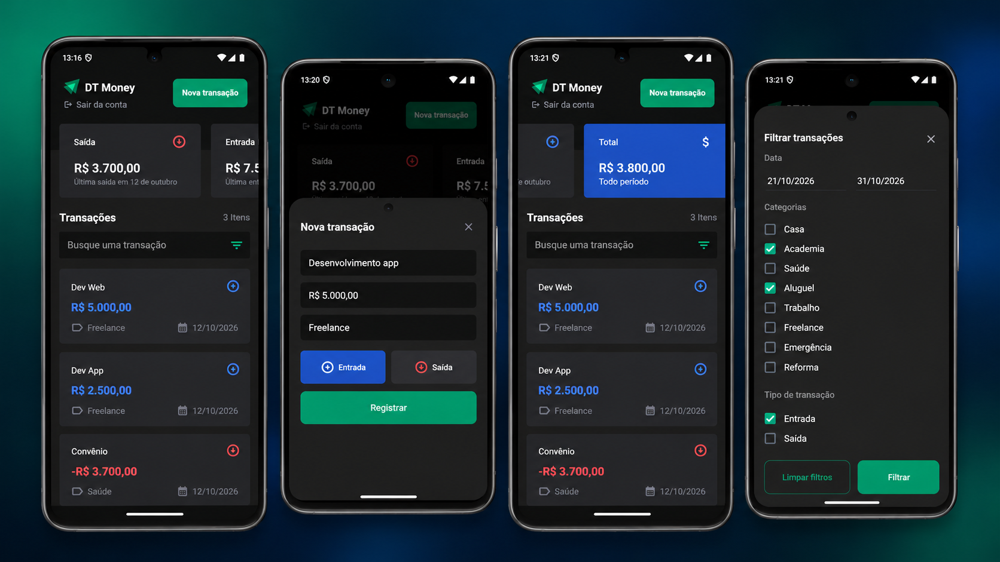

<div align="center">

# 💸 DT Money

### Controle financeiro na palma da mão

Aplicativo mobile para organizar **entradas, saídas e transações**, com filtros, resumo financeiro e autenticação de usuários. Desenvolvido com **React Native, Expo e TypeScript**, integrado a uma API Back-End.

[](https://reactnative.dev/)
[](https://expo.dev/)
[](https://www.typescriptlang.org/)
[](https://nodejs.org/)

</div>

## 📱 Conheça o aplicativo

<div align="center">
  
</div>

> A imagem apresenta a tela principal, o registro de uma transação, o resumo financeiro e os filtros avançados.

## ✨ Funcionalidades

- **Conta de usuário:** cadastro, login e acesso autenticado.
- **Transações financeiras:** registro de entradas e saídas, edição e exclusão.
- **Resumo financeiro:** visualização de entradas, saídas e saldo total.
- **Pesquisa e filtros:** busca por transações e filtragem por período, categoria e tipo.
- **Interface mobile:** experiência em tema escuro, com componentes reutilizáveis.
- **Integração com API:** comunicação entre o aplicativo e o Back-End para gerenciamento dos dados.

## 🛠️ Tecnologias

| Mobile (Front-End) | API (Back-End) |
| --- | --- |
| React Native | Node.js |
| Expo | TypeScript |
| TypeScript | TypeORM |
| NativeWind | SQLite |
| Context API | Rotas de autenticação e transações |
| Axios | Migrations e seeders |

## 📂 Estrutura do repositório

```text
dtmoney/
├── dt-money-app/                    # Aplicativo React Native / Expo
│   ├── src/
│   └── package.json
├── dt-money-react-native-backend/   # API
│   ├── src/
│   └── package.json
├── docs/
│   └── images/
│       └── dtmoney-preview.png      # Imagem com as quatro telas
└── README.md
```

## ▶️ Como executar localmente

### Pré-requisitos

- Node.js e Yarn instalados;
- Android Studio e emulador Android configurados (ou dispositivo Android conectado);
- Ambiente de desenvolvimento React Native / Expo configurado.

### 1. Clonar o projeto

```bash
git clone https://github.com/NandoAmadoDev/dtmoney.git
cd dtmoney
```

### 2. Iniciar a API

Em um terminal:

```bash
cd dt-money-react-native-backend
yarn install
yarn dev
```

> **Configuração local:** o Back-End pode depender de variáveis de ambiente (`.env`) e da preparação do banco SQLite. Configure-as localmente conforme o projeto; **não publique credenciais ou o banco de dados no GitHub**.

### 3. Iniciar o aplicativo

Em outro terminal, a partir da raiz do repositório:

```bash
cd dt-money-app
yarn install
npx expo run:android --clear
```

O `--clear` limpa o cache do Metro. Ele é opcional nas execuções seguintes.

> **Conexão com a API:** confirme que o endereço configurado em `dt-money-app/src/shared/api/dt-money.ts` aponta para o Back-End. No emulador Android, o host `10.0.2.2` normalmente permite alcançar a máquina de desenvolvimento; em um celular físico, use um endereço de rede acessível pelo aparelho.

## 🧪 Qualidade e validação

O projeto passou por verificação de tipos com TypeScript, análise estática com ESLint e testes manuais no Android. Os seletores de data foram ajustados para a API atual do componente de data, mantendo o fluxo de confirmação no iOS no código; a interação no iOS deve ser validada em dispositivo compatível.

Para repetir as verificações no Front-End:

```bash
cd dt-money-app
npx tsc --noEmit
npx expo lint
```

## 🎯 Aprendizados

Este projeto faz parte da evolução dos meus estudos em desenvolvimento mobile e integração de aplicações com APIs, com foco em componentização, gerenciamento de estado, autenticação, formulários, filtros e persistência de dados.

## 👨‍💻 Autor

**Fernando Amado** — Desenvolvimento de Software

[GitHub: @NandoAmadoDev](https://github.com/NandoAmadoDev)

## 📚 Créditos

Projeto realizado para fins de estudo, com base no conteúdo e no projeto-base da **Rocketseat**. Os ajustes e a organização deste repositório refletem minha prática e evolução durante o aprendizado.
